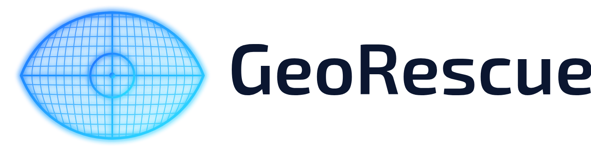

<p align="center"><picture>
  <source media="(prefers-color-scheme: dark)" srcset="brand/logo-horizontal.png">
  <source media="(prefers-color-scheme: light)" srcset="brand/logo-horizontal-light.png">
  
</picture></p>

> **Status:** early prototype, work in progress.

> **Test demo — not authoritative.** Not a survey, title opinion, or legal determination; for testing and demonstration only.
> Results are automated, experimental **data quality test results** computed from public data. Verdicts are proposals, not findings;
> placements of deed descriptions are best-fit, not measured in the field. Consult a licensed surveyor and mapper or an attorney and the
> official records. GeoRescue is not affiliated with the City of Jacksonville, the Duval County Clerk of Courts or the Duval County
> Property Appraiser. See [TERMS.md](TERMS.md). Questions, corrections or removal requests: open an issue at
> https://github.com/knightchrism/georescue/issues

# GeoRescue (V1 core)
GIS data-quality & repair for parcel datasets. Load (SHP/GPKG/GeoJSON) → inspect → classify issues → propose repairs on a copy (every change logged) → export `corrected.gpkg`, `changelog.csv`, `issues.csv`, `diff.csv`, `summary.json`, `report.html`.

## Checks
missing/empty/invalid geometry · duplicate IDs · duplicate geometries · required attributes & types (YAML rules, Pydantic-validated) · CRS missing/unexpected · out-of-bounds · overlaps · slivers · small gaps · original-vs-corrected diff.

## Repairs (all logged: feature_id, check, action, before, after, reason, post_valid, applied)
make_valid (polygonal parts kept) · numeric text→number coercion · assign CRS if missing · optional: drop empty geoms, drop exact duplicates, trim overlaps below an area. Everything else is `flag_only`. The source file is never modified.

## Usage
```
uv sync
uv run georescue inspect data.gpkg -c configs/columbia_fl.yaml
uv run georescue repair  data.gpkg -c configs/columbia_fl.yaml -o out/
uv run georescue report  data.gpkg -c configs/columbia_fl.yaml -o out/
uv run streamlit run app.py          # demo UI (docs/demo.png)
uv run georescue-mcp                 # MCP stdio server: inspect_dataset, repair_dataset
uv run pytest
```
Real data: `uv run python scripts/fetch_columbia.py` (Columbia County FL LCParcels FeatureServer).

## Known gaps
Gap detection uses holes in the unioned fabric (misses gaps open to the outside edge); overlap trimming is greedy (higher row loses); DuckDB batch mode not implemented; no map of issue geometries in the UI (points only); type rules don't parse unit-suffixed text (e.g. "3 Ac").

## Automated vs. manual steps

| Step | Status |
|---|---|
| Inspect, classify, repair, change log, QA report | Automated (`georescue` CLI / MCP) |
| RustGIS visualization loop | Automated (`agent_demo/run_demo.py`) |
| Appraiser legal descriptions, PLSS corner tie (BLM CadNSDI) | Automated (`verify/`) |
| **Fetching recorded deed images** (myfloridacounty.com ORI) | **Manual today**: portal sits behind a human-verification check |
| Deed OCR, metes-and-bounds + curve parsing, COGO traverse, closure and GIS comparison | Automated (`verify/run_deeds.py`) |
| Final boundary position within ~3 ft | Needs a licensed surveyor |

Deed PDFs, page images, and raw county data are excluded from the repo.

## Credits

See [THIRD_PARTY_NOTICES.md](THIRD_PARTY_NOTICES.md) for open-source licenses and data sources.

## Live demo

Static dashboard (GitHub Pages): **https://knightchrism.github.io/georescue/** (placeholder until Pages is enabled)

- KPIs per check, filterable issues table, Leaflet map of *flagged parcels only* (small GeoJSON, not the 584 MB county layer),
  per-overlap case files (verdict, confidence, ORB refs, deed closure/acreage, overlay PNGs) and run history.
- Basemap: OpenStreetMap tiles. The COJ Duval orthoimagery has no published licence, so imagery-backed figures are **not** published;
  case pages use the plain (no-imagery) overlay PNGs.

```bash
PYTHONPATH=. uv run --extra verify georescue run --config configs/duval_fl.yaml   # -> out/runs/<ts>/, out/latest/
PYTHONPATH=. uv run --extra verify georescue publish                               # -> site/
python -m http.server -d site 8765                                                  # preview locally
```

Automation: `.github/workflows/pipeline.yml` (weekly cron + manual dispatch) runs the pipeline on a bbox extract
(`configs/duval_fl_ci.yaml`), fetching parcels at runtime, and deploys `site/` to Pages.
To enable: push the repo to GitHub, then *Settings → Pages → Source: GitHub Actions*, and allow Actions under *Settings → Actions*.
Only invalid-geometry repair is ever auto-applied; every other fix is a proposal recorded in `changelog.csv`.


## Data sources

GeoRescue does not own the data below and is not affiliated with, or endorsed by, any of these sources. Their records are maintained
for their own purposes (for example, assessment) and, as the Property Appraiser states for its data, are **not intended for legal use**
such as conveyances or boundary determinations.

- City of Jacksonville GIS — parcels (CityBiz/Parcels service): https://maps.coj.net/coj/rest/services/CityBiz/Parcels/MapServer/0 · home/disclaimer: https://maps.coj.net/
- Duval County Property Appraiser: https://paopropertysearch.coj.net/Basic/Search.aspx (disclaimer shown on the search site)
- Duval County Clerk of Courts — Official Records: https://or.duvalclerk.com · disclaimer: https://www.duvalclerk.com/disclaimer

Owner and person names are removed from the public site (`georescue publish` redacts by default; `--no-redact-owners` is for private local builds only).

## Glossary

The site's [glossary](https://knightchrism.github.io/georescue/glossary.html) (generated by `georescue publish` from `src/georescue/glossary.py` and the config thresholds) explains every issue type the checks emit — what it means, why it matters, how it is detected, what (if anything) is done automatically — plus terms like verdict, confidence, deed traverse/COGO, misclosure, POB, ORB, IoU and PAO. All results are proposed test results, not authoritative.

## Terms

See [TERMS.md](TERMS.md). Questions, corrections or removal requests: open an issue at https://github.com/knightchrism/georescue/issues
